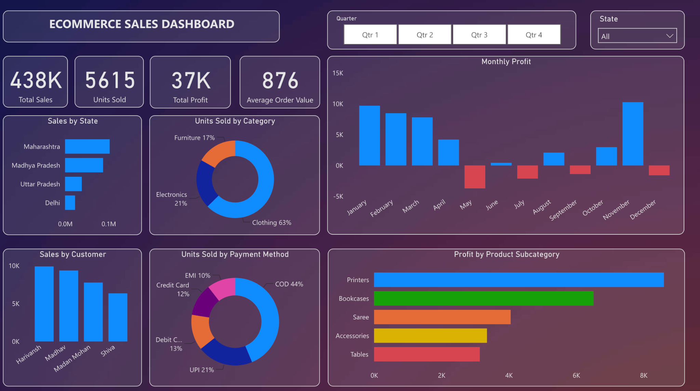

# Ecommerce Sales Analysis | Power BI Dashboard

An interactive Power BI report for exploring e-commerce sales performance across products, customers, locations, payment methods, and time. The dashboard brings key metrics together with filters for **quarter** and **state**, making it easier to identify sales patterns and profitability trends.

## Dashboard at a glance

| KPI | Displayed value |
| --- | ---: |
| Total Sales | 438K |
| Units Sold | 5,615 |
| Total Profit | 37K |
| Average Order Value | 876 |

*Values are rounded or formatted as displayed in the report screenshot. Results can change when slicers are applied.*

## Business questions

- How do sales and profit perform overall?
- Which months are strongest or weakest for profit?
- Which product categories contribute the most units sold?
- Which states and customers generate the most sales?
- How do payment methods compare in transaction-detail quantities?
- Which product subcategories contribute the most profit?

## Key findings

The following observations reflect the dashboard view shown above (with the state slicer set to **All**):

1. **Clothing leads unit volume:** Clothing accounts for approximately **63%** of units sold, ahead of Electronics (**21%**) and Furniture (**17%**). Percentages are rounded as displayed.
2. **Cash on Delivery leads the payment-method mix:** COD represents approximately **44%** of the quantities shown, followed by UPI (**21%**).
3. **November has the highest monthly profit:** The monthly chart shows a strong November result, while **May, July, September, and December** have negative profit.
4. **Maharashtra leads the displayed states in sales:** It has the longest bar among the four states shown in the Sales by State visual.
5. **Printers contribute the most profit among displayed subcategories:** Bookcases rank second in the Profit by Product Subcategory chart.

These are descriptive findings from the current dashboard view, not forecasts or causal conclusions.

## Report visuals

| Visual | Purpose |
| --- | --- |
| **Monthly Profit** | Compare profit across months and identify negative periods |
| **Sales by State** | Compare sales among displayed states |
| **Units Sold by Category** | Examine product-category share of units sold |
| **Sales by Customer** | Compare sales across displayed customers |
| **Units Sold by Payment Method** | Understand quantity distribution across payment methods |
| **Profit by Product Subcategory** | Compare profit contribution by subcategory |

**Interactive slicers:** Quarter and State.

## Data model

The report uses two related tables:

| Table | Role | Example fields |
| --- | --- | --- |
| `Orders` | Order-level attributes | `Order ID`, `Order Date`, `CustomerName`, `State`, `City` |
| `Details` | Order line details | `Order ID`, `Amount`, `Profit`, `Quantity`, `Category`, `Sub-Category`, `PaymentMode` |

`Orders` and `Details` are connected by `Order ID` in a **one-to-many relationship**, allowing order-level filters to affect detail-level visuals.

## Tools and techniques

- **Power BI:** Interactive reporting, charts, KPI cards, and slicers
- **DAX:** Measures and metric calculations, including the displayed Average Order Value measure
- **Data modeling:** Relationship between order-level and line-item tables

> **Metric note:** The dashboard displays an Average Order Value of **876**. Its exact DAX definition should be checked in the semantic model before adding a formula to this README; the displayed value alone does not establish whether the measure uses order count, quantity, or another denominator.

## Repository layout

Ecommerce_Sales_Analysis/
├── README.md
├── Ecommerce Sales Dashboard.pbix
└── images/
    └── dashboard.png

## How to explore the report

1. Open the Power BI report in Power BI Desktop (Windows), or use the Power BI Service if you have access to the published report.
2. Review the four KPI cards for an overview of performance.
3. Use the **Quarter** and **State** slicers to narrow the analysis.
4. Explore monthly profit, category distribution, payment methods, customers, and product subcategories.

## Author

**Saxi Patel** — GitHub: [saxipatel](https://github.com/saxipatel)
